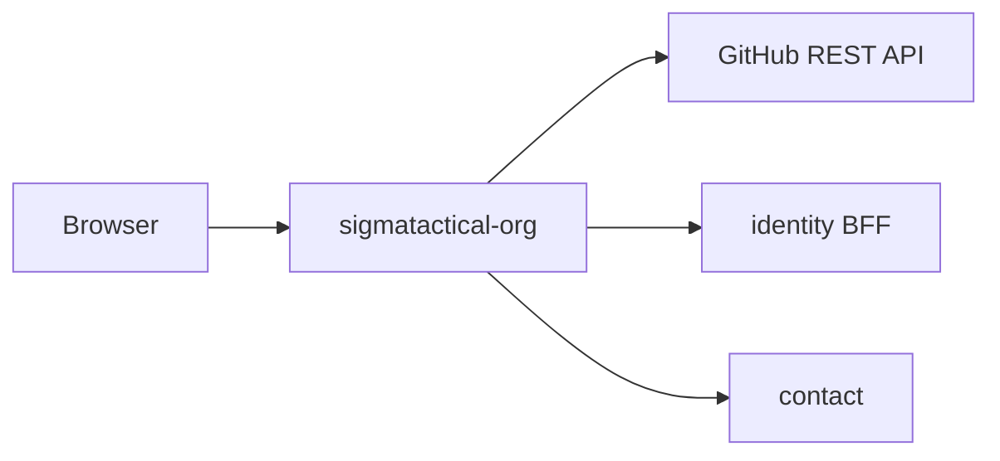

# sigmatactical-org architecture

`sigmatactical-org` is the public open-source showcase at `sigmatactical.org`. Browsers request the site directly; it fetches public GitHub organisation metadata and workflow status, while its theme chrome connects visitors to the identity BFF, contact service, and cart service.

## Context

This service owns no database: its health routes are registered without a pool.

## Runtime shape

`src/main.rs` hands `sigmatactical_org::routes()` to `sigma_theme::warp::run_service`, which builds the multithreaded Tokio runtime and serves until shutdown. The address is selected from `PORT`; the theme crate handles the Warp server lifecycle, static assets, themed rejections, security headers, and health routes.

The service is stateless. A process-wide `TtlCache` retains the repository listing for 30 minutes with single-flight refresh and stale-on-error behaviour, and a `OnceLock` retains the shared navigation HTML.

## Request flow

`index_route()` matches `GET /` and calls `index_page()`. `repos::list_public_repos()` calls the configured GitHub API endpoint for up to 100 public repositories, removes archived repositories and forks, then concurrently requests the latest default-branch `ci.yml` workflow run for each curated repository.

The `catalog` module enriches repository records with editorial descriptions and assigns them to sections. `templates::render_index_html()` returns the page. If an initial GitHub request fails, `index_page()` logs the failure and renders the unavailable notice rather than returning an error. `site_routes()` additionally exposes `/up`, `/health`, `/static/*`, and `/favicon.ico`.

## Code map

| Path | Responsibility |
| --- | --- |
| `src/main.rs` | Names the service and hands its routes to the theme's `run_service`. |
| `src/lib.rs` | Defines the root handler and wraps it with theme, health, CSP, and error routes. |
| `src/config.rs` | Reads public URLs and GitHub organisation, token, and API-base configuration. |
| `src/repos.rs` and `src/repos/*.rs` | Fetch, filter, cache, model, and decorate GitHub repository and workflow-run results. |
| `src/catalog.rs` and `src/catalog/*.rs` | Maintain curated metadata and group repository views into ordered sections. |
| `src/templates.rs` and `src/templates/index_template.rs` | Render themed navigation and catalogue sections through Askama. |
| `templates/index.html` | Open-source showcase page template. |
| `tests/http.rs` and `tests/isolated_env.rs` | Exercise HTTP behaviour and isolated environment settings. |

## Data

This service is stateless and owns no PostgreSQL schema or tables. Repository metadata and workflow status are cached in memory only, so an instance restart initiates a fresh GitHub fetch.

## Configuration

| Environment variable | Purpose |
| --- | --- |
| `PORT` | Listen port supplied to the theme crate. |
| `STORG_PUBLIC_BASE_URL` | Public base URL used by shared chrome. |
| `STORG_IDENTITY_PUBLIC_URL` | identity BFF URL used by navigation and CSP `connect-src`. |
| `STORG_CONTACT_PUBLIC_URL` | Contact-service URL used by shared chrome. |
| `STORG_CART_PUBLIC_URL` | Cart-service URL used by shared chrome. |
| `STORG_GITHUB_ORG` | GitHub organisation to list; defaults to `sigmatactical-org`. |
| `STORG_GITHUB_TOKEN` | Optional GitHub bearer token; takes precedence over `GITHUB_TOKEN`. |
| `GITHUB_TOKEN` | Fallback optional GitHub bearer token. |
| `STORG_GITHUB_API_BASE` | Optional GitHub REST API base, primarily for tests. |

## Deployment

`Dockerfile` builds image `sigmatactical-org`. The Deployment at `../platform/services/sigmatactical-org/base/deployment.yaml` listens on container port `8080`; `../platform/services/sigmatactical-org/base/service.yaml` maps service port `80` to it. Both platform probes use `GET /up`.

Istio routing and environment overlays are in `../platform/services/sigmatactical-org/`. Refer to [`../platform/README.md`](../platform/README.md) for hostnames and platform conventions.

## Testing

Run `cargo test`. Tests cover GitHub payload filtering, repository enrichment and grouping, workflow-status propagation, rendering of repository cards and GitHub failures, and HTTP or isolated-environment integration cases.

The GitHub API base is configurable, allowing integration tests to exercise repository retrieval against a local endpoint rather than the public API.

## Design notes

- GitHub API failures preserve a previously cached listing and otherwise degrade to a visible unavailable state.
- Workflow status is supplementary: an individual status lookup failure leaves its repository visible without a status pill.
- The curated catalogue supplies stable grouping and copy while still exposing uncurated public repositories under the platform section.
- The optional token raises GitHub rate limits without making authenticated access a runtime requirement.
